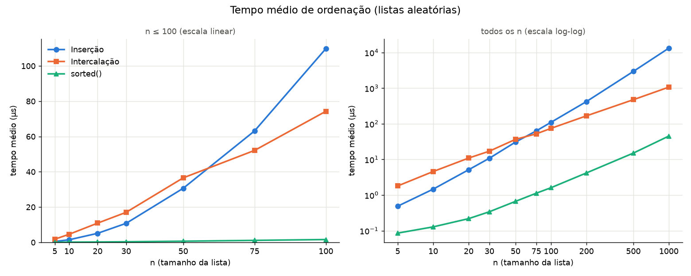
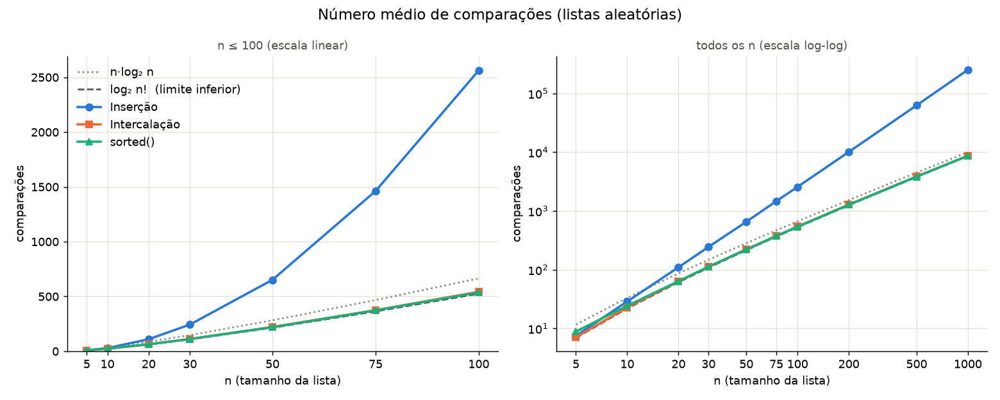

# Relatório — ordenação por inserção × ordenação por intercalação

**Dupla:** João Pedro Mello e Lucas Vieira

**Ambiente da medição:** AMD Ryzen 7 7800X3D, Windows 11, CPython 3.13.14.
**Método:** listas aleatórias de inteiros, 100 repetições por tamanho, média
das repetições (detalhes em [README.md](README.md#como-as-medições-são-feitas)).
Os números brutos estão em [dados.csv](dados.csv). Rodar `python medir.py`
refaz tudo; os tempos mudam um pouco a cada execução e de máquina para máquina,
mas as comparações saem idênticas, porque a semente é fixa.

## Tabela de tempos

Tempo médio de **uma** ordenação, em microssegundos.

| n | Inserção (µs) | Intercalação (µs) | sorted() (µs) | mais rápido (inserção × intercalação) |
|---:|---:|---:|---:|:---|
| 5 | 0.49 | 1.80 | 0.09 | inserção |
| 10 | 1.46 | 4.57 | 0.13 | inserção |
| 20 | 5.12 | 10.90 | 0.22 | inserção |
| 30 | 10.78 | 17.03 | 0.34 | inserção |
| 50 | 30.66 | 36.57 | 0.66 | inserção |
| 75 | 63.17 | 52.12 | 1.13 | intercalação |
| 100 | 109.83 | 74.30 | 1.61 | intercalação |
| 200 | 420.04 | 166.80 | 4.17 | intercalação |
| 500 | 2944.76 | 473.62 | 15.03 | intercalação |
| 1000 | 13236.61 | 1065.22 | 45.15 | intercalação |

## Tabela de comparações

Número médio de comparações (chamadas de `<`) por ordenação. As duas últimas
colunas são referências teóricas, usadas no item extra.

| n | Inserção | Intercalação | sorted() | n·log₂ n | ⌈log₂ n!⌉ |
|---:|---:|---:|---:|---:|---:|
| 5 | 7.5 | 7.1 | 8.8 | 11.6 | 7 |
| 10 | 28.7 | 22.7 | 24.2 | 33.2 | 22 |
| 20 | 109.7 | 63.2 | 63.8 | 86.4 | 62 |
| 30 | 243.6 | 111.9 | 111.7 | 147.2 | 108 |
| 50 | 651.9 | 221.8 | 219.2 | 282.2 | 215 |
| 75 | 1462.2 | 374.7 | 373.2 | 467.2 | 364 |
| 100 | 2563.1 | 542.7 | 537.0 | 664.4 | 525 |
| 200 | 10089.2 | 1281.5 | 1271.5 | 1528.8 | 1246 |
| 500 | 62593.8 | 3855.5 | 3829.6 | 4482.9 | 3768 |
| 1000 | 251877.6 | 8704.4 | 8658.2 | 9965.8 | 8530 |

Os valores batem com a teoria: a inserção faz em média cerca de n²/4
comparações (para n = 1000, n(n−1)/4 + n − Hₙ ≈ 250 742; medimos 251 878), e a
intercalação fica perto de n·log₂ n − 1,25n (≈ 8 716 para n = 1000; medimos
8 704).

## Gráficos

Cada gráfico tem dois painéis: à esquerda, n ≤ 100 em escala linear, onde dá
para ver as curvas se cruzando; à direita, todos os n em escala log-log. No
log-log, uma reta de inclinação 2 é um custo quadrático e uma de inclinação ≈ 1
é n log n — é isso que se vê para inserção e intercalação.

### Tempo

### Comparações

## Em que n a intercalação passa a ser mais rápida

**Em tempo, a intercalação passa a ser mais rápida entre n = 50 e n = 75.** Até
n = 50 a inserção ganha em todos os tamanhos medidos; de n = 75 em diante a
intercalação ganha em todos. Interpolando linearmente a diferença entre os dois
tempos (−5,9 µs em n = 50 e +11,1 µs em n = 75), o cruzamento fica por volta de
**n ≈ 60**. Esse valor depende da máquina e da versão do Python, mas em CPython
costuma ficar nessa faixa de algumas dezenas.

## Os dois gráficos dão o mesmo ponto de virada?

**Não.** Em comparações, a intercalação já empata em n = 5 (7,1 × 7,5) e ganha
claramente a partir de n = 10 (22,7 × 28,7). Em tempo, ela só ganha a partir de
n ≈ 60. Ou seja: entre n = 10 e n = 50, a intercalação faz **menos**
comparações e mesmo assim é **mais lenta**.

O motivo é que contar comparações mede só uma parte do trabalho. O tempo real é
aproximadamente *(comparações × custo de uma comparação) + todo o resto*, e o
"resto" é muito diferente nos dois algoritmos:

- **Intercalação** faz cerca de n chamadas recursivas (cada chamada de função
  em Python custa caro), cria listas novas a cada nível com os fatiamentos
  `lista[:meio]` e `lista[meio:]`, e monta o resultado com `append` e
  `extend` — cerca de n·log₂ n cópias de elementos e muitas alocações de memória.
- **Inserção** é um único laço sobre uma única lista, sem chamadas de função e
  sem alocar nada além da cópia inicial. O trabalho extra por comparação é só
  deslocar um elemento uma posição.

Assim, o custo por comparação da intercalação é várias vezes maior que o da
inserção. Para n pequeno, a vantagem dela em número de comparações é pequena e
não compensa essa constante maior; só quando a diferença entre n²/4 e
n·log₂ n fica grande o suficiente (n ≈ 60 aqui) é que a ordem de crescimento
vence a constante.

Um corolário: se cada comparação fosse cara (strings longas, objetos com
`__lt__` complicado), o custo das comparações dominaria o "resto" e o ponto de
virada do tempo se aproximaria do ponto de virada das comparações.

## Por que a comparação com `sorted()` não serve para decidir entre os dois

O `sorted()` foi mais rápido que os dois em todos os tamanhos — 24 vezes mais
rápido que a intercalação e quase 300 vezes mais rápido que a inserção em
n = 1000. Isso não diz nada sobre qual dos nossos dois algoritmos é melhor,
porque o `sorted()` difere deles em mais de uma coisa ao mesmo tempo:

1. **É outro algoritmo.** O `sorted()` usa o Timsort (desde o Python 3.11 com a
   regra de intercalação do Powersort), que é um híbrido: acha trechos já ordenados,
   usa inserção binária em trechos pequenos e intercalação para juntar os
   trechos. Ele não é nem um nem outro dos nossos.
2. **É escrito em C**, não em Python. Grande parte da diferença de tempo vem de
   não pagar o interpretador a cada operação — por isso ele faz praticamente o
   mesmo número de comparações que a nossa intercalação (8 658 × 8 704 em
   n = 1000) e mesmo assim é 24 vezes mais rápido.

Como ele é mais rápido que os dois, a comparação com ele só mostra "o
`sorted()` ganha de ambos". Para decidir entre inserção e intercalação é
preciso compará-las uma com a outra, nas mesmas condições (mesma linguagem,
mesmas listas, mesma forma de medir), que é o que as tabelas acima fazem. O
`sorted()` serve como referência de quão longe uma implementação ingênua em
Python está de uma implementação de produção, não como critério de escolha.

## Um caso em que a inserção ainda seria a escolha adequada

**Listas quase ordenadas.** O custo da inserção é proporcional a n mais o
número de inversões (pares fora de ordem). Numa lista já ordenada ela faz só
n − 1 comparações (verificado em `testes.py`), enquanto a intercalação faz no
mínimo (n/2)·log₂ n, mesmo sem nada para arrumar. Um caso concreto: um placar
ou uma lista de eventos por horário que já está ordenada e recebe alguns
elementos novos no fim — reordenar com inserção é praticamente linear.

Outros casos em que a inserção é adequada:

- **Listas pequenas** (aqui, n até cerca de 50): é mais rápida, como mostra a
  tabela de tempos. É exatamente por isso que o próprio Timsort usa inserção
  binária para trechos com menos de ~64 elementos e que implementações reais
  de intercalação trocam para inserção quando a sublista fica pequena.
- **Pouca memória**: a inserção ordena no lugar, com O(1) de memória extra; a
  intercalação precisa de O(n) de memória auxiliar.
- **Dados chegando um a um** (ordenação *online*): cada elemento novo é
  inserido na posição certa sem reordenar o resto.

## Extra: comparações do `sorted()`

Usamos a dica do enunciado: `ordenacao.Contado` guarda o valor e incrementa um
contador compartilhado a cada chamada de `__lt__`. O `sorted()` só compara
elementos com `<`, então o contador registra todas as comparações dele. A
coluna "sorted()" da tabela de comparações vem daí.

O limite visto em aula é que qualquer ordenação baseada em comparações precisa,
no pior caso (e também em média), de pelo menos **⌈log₂ n!⌉** comparações, que é
**Θ(n log n)** — pela aproximação de Stirling, log₂ n! ≈ n·log₂ n − 1,44n. As
duas colunas de referência na tabela são n·log₂ n e ⌈log₂ n!⌉, e ambas aparecem
no gráfico de comparações.

| n | sorted() | ⌈log₂ n!⌉ | sorted() ÷ log₂ n! | n·log₂ n | sorted() ÷ n·log₂ n |
|---:|---:|---:|---:|---:|---:|
| 10 | 24.2 | 22 | 1.10 | 33.2 | 0.73 |
| 100 | 537.0 | 525 | 1.02 | 664.4 | 0.81 |
| 1000 | 8658.2 | 8530 | 1.015 | 9965.8 | 0.87 |

Conclusões:

- O `sorted()` fica **acima do limite inferior** em todos os tamanhos, como
  tem que ser, e **muito perto dele**: em n = 1000 faz só 1,5% a mais que
  log₂ n!. Na prática ele é quase ótimo em número de comparações.
- Ele fica **abaixo de n·log₂ n**. Isso não contradiz a teoria: o limite é
  Ω(n log n), uma ordem de crescimento, e o valor exato é log₂ n!, que é menor
  que n·log₂ n por um termo ≈ 1,44n.
- Em listas aleatórias, ele faz praticamente o mesmo número de comparações que a
  nossa intercalação (diferença de cerca de 1% ou menos a partir de n = 30). Isso era
  esperado: sem trechos pré-ordenados para aproveitar, o Timsort se reduz a
  inserção binária em blocos pequenos mais intercalação.
- Em n = 5 o `sorted()` faz 8,8 comparações, mais que a intercalação (7,1) e
  que o limite (7). Para listas pequenas, antes de ordenar o Timsort gasta
  comparações procurando um trecho já ordenado (crescente ou decrescente) no
  início; com n = 5 esse custo fixo pesa relativamente mais.
